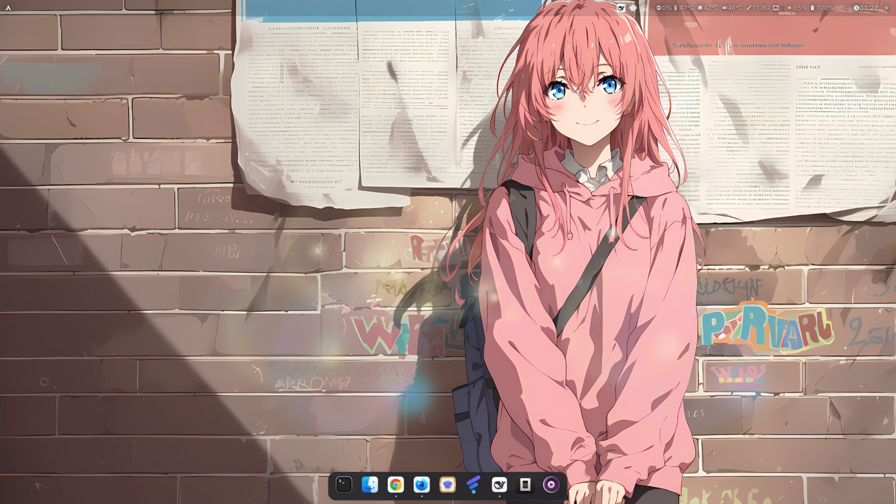
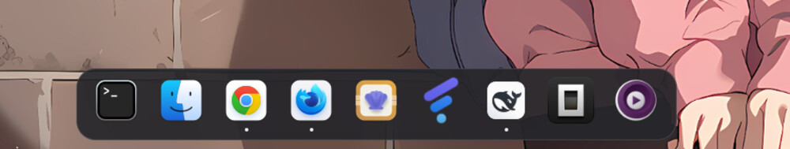
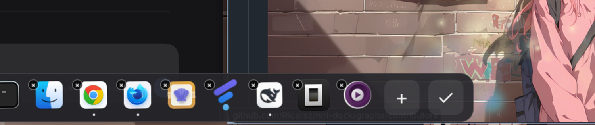
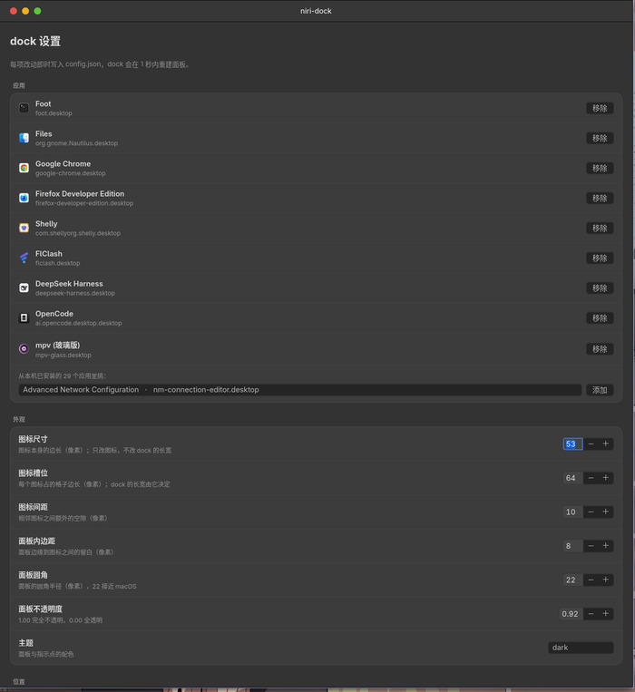

# niri-dock

给 [niri](https://github.com/YaLTeR/niri) 用的 macOS 风格 dock。GTK4 + gtk4-layer-shell，窗口列表直接读 niri IPC（`NIRI_SOCKET`），不依赖 wlr-foreign-toplevel。





## 特性

- 贴边居中、圆角半透明面板（想要磨砂效果，可在 niri 里给 `niri-dock` 加 `layer-rule` 的 `background-effect { blur true }`）
- 悬停放大：鼠标下的图标放大，左右邻居递减，macOS 同款；放大部分预留了图层空间，任何设置下都不会被面板边裁切
- 启动弹跳：点按未运行的应用，图标上下弹几下
- 运行指示点：有窗口的应用在图标下显示小圆点（跨工作区统计）
- 左键：已运行 → 聚焦（多窗口时依次切换）；未运行 → 启动
- 右键：应用菜单（新窗口 / 退出）
- 自动隐藏：鼠标离开后滑下；触发带横贯整条屏幕边，光标碰到边缘任意位置就弹出
- 设置窗口：图标尺寸/间距、停靠边、明暗主题、不透明度、动画时长都在 GUI 里调，改完立刻生效
- 应用列表在设置里增删，顺序在 dock 的编辑模式里拖动调整

## 依赖

- `rust` / `cargo`
- `gtk4`、`gtk4-layer-shell`
- 运行中的 niri 会话（需要 `NIRI_SOCKET`）

## 安装

从 [Releases](https://github.com/Ricarsz/niri-dock/releases) 下载打好的 pacman 包并用 `paru` / `pacman` 安装：

```sh
paru -U niri-dock-<version>-1-x86_64.pkg.tar.zst
```

或者用仓库里的 `PKGBUILD` 自己构建安装（构建目录放外面，免得和源码 `src/` 打架）：

```sh
BUILDDIR=/tmp/niri-dock-build makepkg -si
```

只想编个二进制、不装系统包：

```sh
cargo build --release
install -Dm755 target/release/niri-dock ~/.local/bin/niri-dock
```

自启（niri）：

```kdl
spawn-at-startup "niri-dock"
```

磨砂（niri，可选）：

```kdl
layer-rule {
    match namespace="^niri-dock$"
    background-effect {
        blur true
    }
}
```

## 设置窗口

```sh
niri-dock --settings
```

外观 / 位置 / 行为三组设置，改动即时写入 `config.json`，dock 1 秒内自动重建面板，不用重启。
「恢复默认外观」只重置外观与行为，保留 dock 上的应用列表。

建议绑个快捷键（`~/.config/niri/config.kdl`）：

```kdl
binds {
    Mod+Shift+D { spawn "niri-dock" "--settings"; }
}
```

## 命令行

```sh
niri-dock              # 前台运行（已在运行则激活现有实例）
niri-dock start        # 后台启动
niri-dock stop         # 停止
niri-dock restart      # 重启
niri-dock status       # 是否在跑 / 版本 / 配置路径 / 图标数
niri-dock toggle       # 显示或隐藏
niri-dock show|hide    # 显式显示 / 隐藏
niri-dock reload       # 重新读配置并刷新
niri-dock edit         # 进入 / 退出图标编辑模式
niri-dock quit         # 退出
niri-dock settings     # 打开设置窗口
niri-dock dump         # 打印每个图标匹配到的窗口
```

进程管理靠 `$XDG_RUNTIME_DIR/niri-dock.pid`，显隐/重载/退出走 GApplication 导出的
D-Bus action，所以不需要额外的守护进程或 socket。

## 编辑 dock 上的图标

设置窗口里点「编辑 dock 图标」，或者：

```sh
niri-dock edit
```





进入后 dock 不会自动隐藏，图标会轻微摇晃，末尾出现一个 `✓`：

- **拖动图标**：按住图标拖到另一个图标的位置换序，落在目标左半边插到它前面、
  右半边插到它后面，松开立即写回配置
- **✓**：退出编辑模式

增删应用都在设置窗口的「应用」一栏：

- 点「移除」把应用移出 dock
- 添加时不用手动挑文件：窗口会自动扫描本机的 `.desktop`（`XDG_DATA_HOME`、
  `XDG_DATA_DIRS` 里的 `applications/`），列出还没加进来的应用，选中点「添加」即可
- 列表已按 desktop id 去重（用户目录优先），并过滤掉 `NoDisplay=true`、
  `Hidden=true` 以及 `TryExec` 指向的程序不存在的条目
- 每个应用名字下面都标着对应的 `.desktop` 文件名，下拉框里也是「名字 · 文件名」，
  方便对不上号的时候确认到底是哪个条目

改动只动 `config.json` 里的 `pins` 数组，其他配置项和未知字段保持不变。

## 配置

`~/.config/niri-dock/config.json`，首次运行自动生成：

```json
{
  "pins": ["foot", "org.gnome.Nautilus", "google-chrome", "firefox-developer-edition"],
  "icon_size": 52,
  "slot": 64,
  "spacing": 12,
  "padding": 8,
  "gap": 10,
  "panel_radius": 22,
  "panel_opacity": 0.92,
  "position": "bottom",
  "theme": "dark",
  "autohide": true,
  "hide_delay_ms": 650,
  "hot_zone": 6,
  "tooltip": true,
  "context_menu": true,
  "reveal_ms": 280,
  "magnify": true,
  "magnify_peak": 1.30
}
```

- `pins`：desktop 文件 id（不带 `.desktop`），按顺序显示
- `icon_size`：图标本身的边长（px），只改图标，不改变 dock 长宽
- `slot`：每个图标占的格子边长（px），**dock 的长宽由它决定**，图标在格子里居中
- `spacing` / `padding`：格子之间的间距、面板内边距（px）
- `gap`：面板离停靠屏幕边的距离
- `panel_radius` / `panel_opacity`：面板圆角与不透明度
- `position`：`bottom` / `top` / `left` / `right`
- `theme`：`dark` / `light`
- `autohide` / `hide_delay_ms` / `reveal_ms`：自动隐藏、收起延迟、滑出动画时长（ms）
- `hot_zone`：屏幕边缘触发带的厚度（px），这条带横贯整条屏幕边，鼠标碰到任意位置都会唤出 dock
- `magnify` / `magnify_peak`：悬停放大开关与峰值倍数（峰值上限 1.30）

想让图标更小但 dock 不变，只调 `icon_size`；想让 dock 更紧凑，调 `slot` 和 `spacing`。

改完保存即可，dock 会自己重读（不需要重启进程）。

## 调试

```sh
niri-dock --dump                  # 打印每个 pin 匹配到的窗口
NIRI_DOCK_HOVER=2 niri-dock       # 固定第 3 个图标为悬停态（截图用）
NIRI_DOCK_BOUNCE=1 niri-dock      # 启动时触发一次弹跳
NIRI_DOCK_MENU=2 niri-dock        # 直接弹出第 3 个图标的右键菜单
```

## 已知限制

- 只跟踪窗口，不接 SNI 托盘：只在托盘里驻留、没有窗口的后台程序不会出现在 dock 上
- 没有拖拽排序、没有废纸篓
- niri 没有最小化概念，所以没有「最小化窗口」状态
